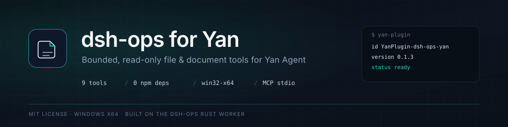
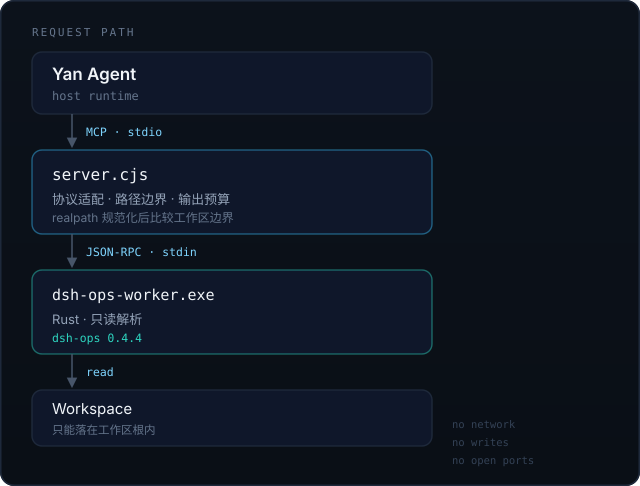

<p align="center">
  
</p>

<p align="center">
  <a href="https://github.com/Solren-zhen/YanPlugin-dsh-ops-yan/actions/workflows/ci.yml"></a>
  
  
  
</p>

<p align="center">
以本地 MCP 服务的形式，把 dsh-ops 的 Rust worker 接入 Yan，提供 9 个有界、只读的文件与文档工具。
</p>

## 为什么需要它

Yan 自带的 `read`、`grep`、`glob` 面向代码与小文件。处理大文件、CSV 宽表、DOCX 正文或 PDF 文本层时，一次性读入很容易占掉大段上下文，而且拿到的结构信息有限。

这个插件把这些操作拆成可预期的分页调用：先取精确事实，再按页读取；每个工具都有明确的行数、页数与文件数上限，响应超出预算时返回截断标记而不是静默丢内容。

- 9 个只读工具，共享同一套分页、截断与错误语义
- 零 npm 依赖，worker 二进制随插件分发
- 路径边界在工作区根内，越界在启动 worker 前拒绝
- 由 Yan 以 stdio 启动，不监听端口，不产生网络请求

## 工具

| 工具 | 用途 | 关键上限 |
|---|---|---|
| `stat` | 文件大小、行数、修订哈希，不读正文 | — |
| `grep` | 工作区内正则检索，返回行级命中或按文件计数 | 1–10000 条 |
| `glob` | 按 glob 枚举路径，返回相对路径 | 1–10000 条 |
| `read_files` | 一次读取 1–32 个文件的行区间 | 每文件 1–10000 行 |
| `read_table` | CSV/TSV 分页读取，附带列名与类型元数据 | offset 1–100000，limit 1–1000 |
| `read_docx` | 提取 DOCX 正文段落 | offset 1–100000，limit 1–1000 |
| `read_pdf` | 提取 PDF 文本层 | offset 1–32，limit 1–32 |
| `diff` | 将候选内容与现有文件对比，只返回变更块 | 1–1000 块 |
| `inspect_local_file` | 文本或十六进制检视，用于编码与损坏排查 | 1–10000 行 |

所有工具均为只读。写入、替换与删除仍使用 Yan 内置工具。

## 安装

1. 打开 设置 → 插件，选择从本地目录安装，指向本仓库根目录。
2. 在插件列表中启用 `dsh-ops for Yan`。
3. 在有工作区的任务中激活插件。`${workspace}` 由宿主注入；Blank 任务没有工作区目录，服务不会启动。

激活后，Yan 会把工具名改写为带哈希前缀的形式。按描述开头的 `[dsh-ops for Yan / ops / <原工具名>]` 识别，不要按字面名调用。

## 工作原理

<p align="center">
  
</p>

`server.cjs` 负责 MCP 协议、工作区边界和响应预算；`dsh-ops-worker.exe` 负责实际解析。路径会先规范化到真实路径再比较边界，交给 worker 的也是真实路径，因此工作区根是 junction 或符号链接时仍能正常工作。

单次响应超过约 96 KB 时由 worker 标记截断，`server.cjs` 另设 1 MB 兜底；超出预算时返回 `{ truncated, truncatedBy, originalBytes, preview }`。

## 实测

验证环境为 Windows 11 x64 + Yan Agent 1.6.0，插件 `0.1.3`，工作区为本仓库。

| 场景 | 结果 |
|---|---|
| `node tests/smoke.mjs` | 14/14 通过 |
| `node tests/bench.mjs` | 17/17 通过（含 DOCX、PDF、CSV、越界与分页） |
| 宿主安装与启用 | `version 0.1.3`、`ready: true`、`enabled: true` |
| 宿主内 `read_pdf` | 2 页文本层正确返回 |
| 宿主内 `read_docx` | 3 段正文正确返回 |
| 宿主内 `read_table`（UTF-8） | 3 行 × 3 列，列名与行号正确 |
| GBK 文件按 UTF-8 读取 | `status: partial` + `ERR_INVALID_ENCODING`，未返回伪成功 |
| 工作区外路径 | 拒绝：`path is outside the workspace` |

逐项记录见 [docs/VALIDATION.md](docs/VALIDATION.md)，发布信息见 [docs/RELEASE.md](docs/RELEASE.md)，上架要求见 [docs/PUBLISHING.md](docs/PUBLISHING.md)。

## 边界

| 项目 | 说明 |
|---|---|
| 平台 | 仅打包 `win32-x64` worker；其他架构会显示就绪，但无法启动 |
| PDF | 只读文本层，单次 1–32 页，不做 OCR，扫描件返回空文本 |
| DOCX | 只读正文段落，不含页眉页脚、批注与表格排版 |
| 表格编码 | 仅支持 `utf-8`、`utf-16le`、`utf-16be` |
| 写入 | 不提供任何写操作 |
| 与内置工具的关系 | 不替换 `read`/`grep`/`glob`；增量在 `stat`、`read_files`、`read_table`、`read_docx`、`read_pdf`、`diff`、`inspect_local_file` |

## 开发

```powershell
node tests/smoke.mjs
node tests/bench.mjs
node scripts/market-entry.mjs --repository <owner>/YanPlugin-dsh-ops-yan --revision <40 位 commit SHA>
```

`tests/`、`scripts/` 与 `.github/` 同样计入插件包摘要和市场文件清单，改动后需要重新生成市场条目。

## 许可与来源

本移植包以 MIT 分发，见 [LICENSE](LICENSE)。上游 [T-Auto/dsh-ops](https://github.com/T-Auto/dsh-ops) 同为 MIT；worker 二进制版本、来源与 sha256 记录在 [NOTICE](NOTICE)。

- worker：`dsh-ops@0.4.4`（npm 发布包，`runtime/win32-x64`），sha256 `607e97c2…3f0f`
- 协议字段与工具参数按上游 `0.5.0-alpha3` 核对
- 未包含任何 GPL 的 bash 载荷
